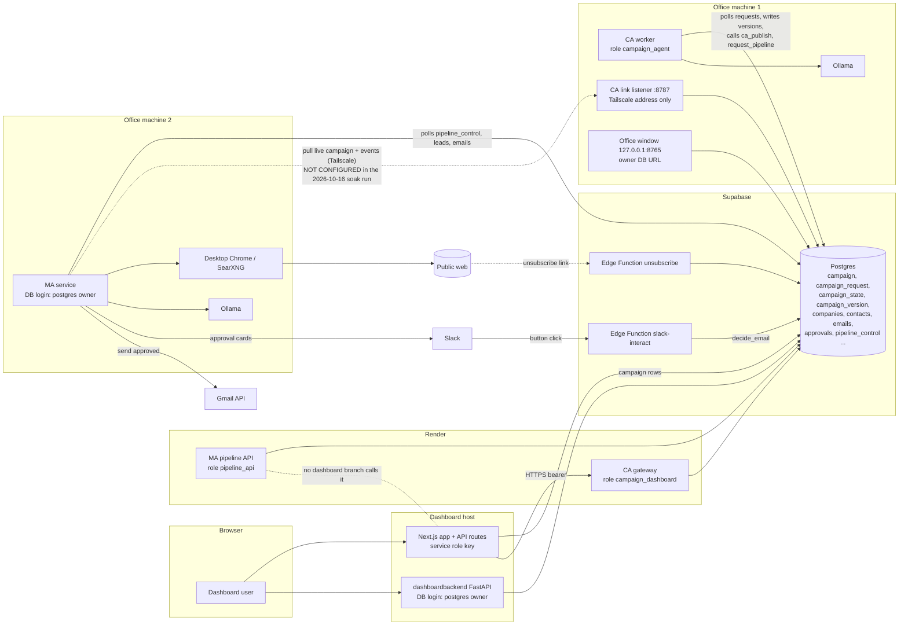

# Codebase audit: Campaign Agent, Marketing Agent and Dashboard (2026-10-17)

Scope: the three repositories on the laptop, at the branches checked out on 2026-10-17.

| Repository | Path on the laptop | Branch / commit | What it is |
|---|---|---|---|
| Campaign-Agent | `~/Desktop/Campaign-Agent` | `feature/qa-soak` @ `ac2f826` | Campaign Agent (CA): worker, dashboard gateway, Tailscale link listener, office window, QA suite |
| Marketing-AI-Agent | `~/Desktop/Marketing-AI-Agent` | `feature/needs-contact` @ `90f35cb` | Marketing Agent (MA): lead pipeline, Slack approval, Gmail sending, pipeline API, Supabase Edge Functions |
| Marketing_Agent | `~/Desktop/Marketing_Agent` | `feature/needs-contact` @ `57f39e1` | Dashboard: Next.js app (`dashboard/`) and FastAPI backend (`dashboardbackend/`) |

Method: static reading of the code, migrations, deploy files and docs; `git` history and branch inspection; the GitHub
Actions API (public); the QA soak results already on disk (`qa/results/20261016-162616`); one parse-only comparison of two
YAML files. Nothing was run against a database, Slack, Gmail or the office machines. Following the standing rule for this
project, no project code, tests or linters were run on the laptop (see section I).

Labels used for every finding:

- **Confirmed**: shown by the code, or by recorded execution evidence.
- **Suspected**: very likely from the code, but it depends on configuration or runtime state that could not be seen.
- **Missing**: required by the business workflow and not implemented.
- **Design risk**: works as written, but fails or is unsafe under conditions that can realistically happen.
- **Untested**: no test exercises it.
- **Environment**: could not be checked from here.

No secret values appear in this report. Where a secret was found, only the file and the variable name are given.

> **Update, same day:** fixes for the findings are on branch `fix/audit-findings` in all three repositories (not merged,
> not yet run in CI). See section N for the state of each finding and the steps that need a person.

---

## A. Executive summary

The code base is far more complete and careful than a typical prototype. Each agent on its own is solid:

- The **CA** turns free text into a validated, versioned leadgen overlay. Approval names the exact `version` and `sha256`
  the person reviewed, is enforced again in the database (`ca_publish`), and is recorded with who and when.
- The **MA** has a single email send path with a gate inside the claiming SQL query, a re-check, a typed `Cleared`
  object, a daily cap, a suppression list and a test redirect. Slack decisions are signature-verified, checked against
  an allow-list and applied exactly once (`decide_email`).
- The **dashboard** keeps all tokens on its server, takes the approver identity from the verified login, and uses
  optimistic locking for campaign edits.

The weaknesses are at the joins between the three systems, not inside them:

1. **The CA to MA handoff did not work in the deployed environment.** In the 2026-10-16 soak run the MA machine had no
   `MA_LINK_URL` / `MA_LINK_TOKEN`, and the end-to-end check failed ("the Marketing Agent never took the file").
2. **The MA runs without an approved campaign.** With no live campaign, no link, or an unreachable CA and no cache, it
   runs its own built-in base config, and an approval's "start the Marketing Agent" starts it either way. In the soak run
   this is what happened: the approval started the MA, which then prospected and drafted on its base config.
3. **Leads and emails are not tied to a campaign.** They carry no campaign id or version, so a campaign that is switched
   off keeps sending its approved emails and follow-ups, and nothing can be reported per campaign.
4. **Key targeting criteria are not enforced.** Location (only a search hint), company size, preferred contact roles and
   custom signals are shown as "not applied". The MA's rules and vocabulary are specific to AOSP and embedded Linux.
5. **The email approval invariant has gaps.** Follow-up and reply drafts are cut at 1,800 characters in Slack, so
   a reviewer can approve text they have not seen. Reply approvals do not record who approved. Approvals are not bound
   to a hash of the content and recipient.
6. **Too much database privilege.** The MA service and the dashboard backend log in as the `postgres` owner of the one
   shared Supabase project. The laptop's MA `.env` holds that owner URL with `EMAIL_SENDING_ENABLED=true`, and the MA
   has no guard against running on the wrong machine.
7. **The cross-agent validation (CA level 6) cannot pass against the real MA.** It calls a CLI flag the MA has never
   had (`--campaign`). The CA tests pass only because they use a stand-in MA that implements it.
8. **CI is red** on the CA's current branch, and the dashboard repository has no CI at all.

**Readiness.**

| Use | Verdict |
|---|---|
| Local testing of each agent on its own | Ready |
| Controlled integration testing (CA + MA + dashboard, test recipient only) | Ready only after findings F-01, F-02 and F-03 are fixed and the link is configured on both machines |
| Production (real outreach to real prospects) | **Not ready.** At least F-01 to F-08 and F-11 must be fixed first |

---

## B. Repository and component inventory

### B.1 Campaign Agent (`Campaign-Agent`)

| Component | Entry point | Responsibility | Runs where |
|---|---|---|---|
| Worker | `python -m campaign_agent start` → `__main__._serve` → `jobs/worker.Worker` | Polls `campaign_request`, runs each request (`jobs/manager.process_next`, `jobs/handlers.handle`), stores state, versions and the live pointer; heartbeat; pause/resume; auto-start of new campaigns; starts/stops the MA pipeline | Office machine 1 (systemd user unit `deploy/campaign-agent.service`) |
| MA link listener | Same process, thread `ma_link/server.LinkServer` | `GET /ma/v1/health`, `GET /ma/v1/campaign/active` (long poll, ETag), `POST /ma/v1/events`; bearer token; binds the Tailscale address only | Office machine 1, port 8787 |
| Dashboard gateway | `python -m campaign_agent api` → `main.create_app` | `POST /v1/campaigns/{id}/requests`, `GET /v1/campaigns/{id}`, `GET /v1/requests/{id}`, `GET /v1/ca`, `POST /v1/ca/state`; shared bearer token; limited DB role `campaign_dashboard` | Render (`render.yaml`), public |
| Office window | `python -m campaign_agent ui` → `console_web.run_ui` | Local page on 127.0.0.1:8765; can create, edit and **approve** campaigns; drives the MA pipeline | Office machine 1 |
| Autopilot | `python -m campaign_agent autopilot` | Leaves a plan for the office window; the window types, answers and approves | Office machine 1 |
| Extractor / LLM | `extractor/`, `llm/` | One model call turns text into an IR patch (Ollama or OpenAI-compatible) | Ollama on office machine 1 |
| Research | `research/` | Bounded concept research through SearXNG; **off by default** (`RESEARCH_ENABLED=false`) | Office machine 1 |
| Compiler / validators | `compiler/`, `validators/` | IR → overlay; levels 1-6 (level 6 runs the MA loader in a network-less subprocess) | Office machine 1 |
| Migrations | `migrations/0013-0024`, `optional/dashboard_auth.sql`; `python -m campaign_agent migrate` | CA tables, roles, publish functions, pause control, auto-start | Shared Supabase |
| QA suite | `qa/` | Soak and acceptance tests run on both office machines | Office machines |

### B.2 Marketing Agent (`Marketing-AI-Agent`)

| Component | Entry point | Responsibility | Runs where |
|---|---|---|---|
| Service | `python -m agent start` → `agent/supervisor.start` | Control loop (polls `pipeline_control`), pipeline passes (`run.daily_run(leads_first=True)`), sender (20 s), manual-contact (30 s), inbox (10 min), CA link sender and watcher | Office machine 2 (`deploy/marketing-agent.service`, `BROWSER_BACKEND=desktop`) |
| Lead pipeline | `agent/leadgen/service.run_leads` → `pipeline.Pipeline` | Search → qualify (rules + one LLM call) → dedup → contact discovery → draft → Slack approval | Office machine 2 |
| Browser backends | `agent/leadgen/browser/{http,chrome,desktop}.py` | HTTP + SearXNG; Playwright Chrome (Bing); visible desktop Chrome via xdotool + OCR | Office machine 2 |
| Approval | `agent/leadgen/approval.py`, `agent/notify.py` | Posts drafts to Slack; dry-run writes files | Slack |
| Slack decisions | `supabase/functions/slack-interact/index.ts` | Verifies the Slack signature, checks the allow-list, calls `decide_email()` or updates reply / post rows | Supabase Edge Function |
| Sending | `agent/leadgen/sender.send_approved`, `agent/mailer.py`, `libs/agentkit/agentkit/gmail.py` | The one send path: claim → re-check → `Cleared` → Gmail API | Office machine 2 |
| Replies / follow-ups | `agent/inbox.py`, `agent/replies.py`, `agent/followups.py` | Poll Gmail, classify, draft answers and follow-ups, queue approved answers | Office machine 2 |
| CA link client | `agent/campaign_link.py` | Pulls the live campaign (sha256 and shape checked, cached), sends events through a local outbox | Office machine 2 |
| Pipeline API | `api/app.py` | REST start/stop/status of the pipeline for the dashboard; limited role `pipeline_api` | Render. **No dashboard branch calls it** (see F-27) |
| Unsubscribe | `supabase/functions/unsubscribe/index.ts` | HMAC-signed one-click unsubscribe | Supabase Edge Function |
| Migrations | `supabase/migrations/0001-0013`; `python -m agent migrate` | Core schema, lead pipeline, pipeline control, needs-contact | Shared Supabase |

### B.3 Dashboard (`Marketing_Agent`)

| Component | Entry point | Responsibility |
|---|---|---|
| Next.js app | `dashboard/app` | Pages: dashboard, campaigns, campaign review, positive leads, needs contact, history, blogs, users, profile |
| Next.js API routes | `dashboard/app/api/*` | Campaign CRUD on `public.campaign` with the **service role key**; proxy to the CA gateway (`core/server/caGateway.js`); Gmail read-only inbox; user admin |
| FastAPI backend | `dashboardbackend/app/main.py` | Read-only lead, email, reply and blog views; one-session-per-account; `POST /needs-contact/{id}/contact` → `submit_manual_contact()`; connects as the **`postgres` owner** (laptop `.env`) |
| Migrations | `dashboardbackend/migrations/001-006` | Applied by hand in the Supabase SQL editor, not tracked |

### B.4 Shared infrastructure

- **One Supabase project** holds the dashboard's `campaign` table, the CA's tables and the MA's tables. The three
  laptop `.env` files point at the same project.
- **Tailscale**: used only for MA → CA (`campaign-agent:8787`). Nothing else crosses it.
- **Slack**: MA bot posts; the Edge Function receives the button clicks.
- **Gmail API**: the MA sends as one account (`token.json`); the dashboard reads one account (read-only scope).
- **Render**: CA gateway (free plan, sleeps after about 15 minutes) and MA pipeline API.

---

## C. Architecture and data flow (as implemented)

Implemented and evidenced: every solid arrow. The dotted MA → CA link is implemented in both repositories but was not
configured on the MA machine in the last recorded run. The pipeline API exists but nothing calls it.

**The real control flow of a campaign:**

1. Dashboard `POST /api/campaigns` inserts `public.campaign` (service role key), then, after answering, asks the gateway
   for `interpret` (`app/api/campaigns/route.js:31`). If that call fails, the CA's auto-start (`ca_auto_interpret`, 0021)
   picks the campaign up after a 20-second grace period.
2. CA worker claims the request (`store/repositories._CLAIM`), runs the extractor, asks questions or validates, freezes a
   candidate version (`campaign_version`) and writes `review_view`.
3. The dashboard polls `GET /v1/campaigns/{id}` through its own route and renders `review_view`.
4. Approve: `{version, sha256, start_pipeline: true}` → `_approve` re-validates → `ca_publish()` sets `approved_*` and
   `active_version_id` (one live campaign in the whole database) → after commit `start_marketing_agent()` calls
   `request_pipeline('running')`.
5. MA control loop sees `desired_state=running`, starts a pass. `run_leads` calls `apply_campaign()`: it pulls the live
   campaign from the CA link if configured, otherwise it uses `config/leadgen.yaml`.
6. Leads → contacts → drafts → Slack → `decide_email()` → sender → Gmail.

---

## D. End-to-end workflow assessment

### Stage 1: Campaign creation

| | |
|---|---|
| Expected | The dashboard submits structured requirements; the CA validates them and creates a record |
| Actual | The dashboard stores **name, free-text detail, start/end dates, active flag** in `public.campaign` (`dashboard/core/server/campaigns.js:159`). There are no structured fields for industry, location, size or services: everything is in `campaign_detail` (max 5,000 characters). The CA reads it on `interpret` (`jobs/handlers._interpret`) |
| Files | `dashboard/app/api/campaigns/route.js`, `core/server/campaigns.js`, CA `jobs/handlers.py`, `migrations/0021`, `0023` |
| Evidence | Code; soak check `ca.lifecycle` passed (13 cases) |
| Missing | No versioned request schema shared between dashboard and CA; requirements are unstructured text. Editing `campaign_detail` after interpretation changes nothing in the CA (F-24) |
| Risks | Creation and the `interpret` call are not atomic, which is covered by auto-start. The CA reads `public.campaign`, a table owned by the dashboard repo, with no shared schema |

### Stage 2: Campaign research

| | |
|---|---|
| Expected | The CA researches the requirements, works out the target profile and writes a campaign file |
| Actual | "Research" is mostly **LLM extraction** from the user's text into an IR, then clarifying questions (`questions/`, `gap/`), defaults and a deterministic compiler. Web research (`research/`) is bounded and safe (domain policy, public-IP check on every redirect, byte caps), but **off by default** (`settings.research_enabled=False`) and only produces suggestions a person must accept |
| Files | `extractor/extractor.py`, `merger/patch_merger.py`, `compiler/compiler.py`, `research/*` |
| Evidence | Code; soak `ca.lifecycle` reached review |
| Missing | No research of target companies or market; the output is a search configuration, not a researched company profile |
| Risks | Output quality depends on one local 9B model (`qwen3.5:9b`) |

### Stage 3: Approval and editing

| | |
|---|---|
| Expected | Approve or request edits; stale approvals refused; identity and timestamps; no bypass |
| Actual | Strong. Explicit state machine (`conversation/state_machine.py`); `edit` needs `base_revision`; approval must name the current candidate's `version` and `sha256` (`handlers._approve:407`) and is re-validated; the DB function `ca_publish` checks again and records `approved_by` / `approved_at` once (`0015`). Idempotency key per request; requests strictly ordered per campaign (`_CLAIM`) |
| Evidence | Code; CA unit and integration tests (`test_publish.py`, `test_worker.py`, `test_roles.py`); soak `ca.lifecycle` passed |
| Missing | A per-person identity for the office window and autopilot (F-13); a gateway check that the approver may approve (F-18) |
| Risks | The CA DB role can insert a pre-approved version (F-14); lease not renewed (F-20) |

### Stage 4: Handoff to the MA

| | |
|---|---|
| Expected | The CA transfers the approved config; the MA validates and starts |
| Actual | Pull model over Tailscale: the MA polls `GET /ma/v1/campaign/active` (long poll, ETag), checks `sha256`, the allowed keys and types (`campaign_link.check_overlay`), and that the CA's complete file equals its own merge (`resolve`); it caches the last good file atomically; events go back through a bounded outbox with retries. The CA serves only approved versions (`live_version_for_ma`). Separately, the CA starts the MA pipeline through the database (`request_pipeline`) |
| Evidence | Code; soak `ca.link` passed (auth, ETag, long poll, idempotent events). **Soak `ca.e2e_real_pass` FAILED**: "no MA_CAMPAIGN_APPLIED event within 10 min: the Marketing Agent never took the file". MA side: "MA_LINK_URL / MA_LINK_TOKEN are not set" |
| Missing | Link configuration on the MA machine (F-01); a delivery check before starting the pipeline (F-02) |
| Risks | Transport is plain HTTP inside WireGuard (acceptable). The token is one shared static secret (rollover supported). The MA keeps running a cached campaign while the CA is unreachable, even if it was switched off meanwhile (the pipeline stop goes through the DB, which limits this) |

### Stage 5: Lead generation

| | |
|---|---|
| Expected | Chrome research; qualification by explicit criteria; validated contacts linked to sources; dedup; idempotent writes |
| Actual | Rules first, then one LLM call per page (`qualify.py`); code checks that quotes appear literally on the page, the company is named, and the website is never guessed; score 0-100 with penalties; dedup by domain and normalised name (`companies.domain unique`); contacts only from the company's own site, with `source_url` mandatory; states `DISCOVERED → QUALIFIED → (NEEDS_CONTACT →) CONTACT_FOUND → EMAIL_DRAFTED → PENDING_APPROVAL → APPROVED → SENT`, each stored and resumable. CAPTCHA and bot checks are skipped, never solved |
| Evidence | Code; MA unit tests (328); soak `ma.search.discovery` passed |
| Missing | Campaign attribution (F-04); enforcement of country, size, roles and signals (F-05); email verification (F-17); robots.txt and private-address checks on the Chrome backends (F-15) |
| Risks | Dedup is global across campaigns (a company found once is never a lead for another campaign); the pass can abort on an unexpected DB error (F-26) |

Discovered, qualified, verified and outreach-ready are distinct states in the MA: `DISCOVERED` = stored from a page,
`QUALIFIED` = score ≥ `min_qualify`, `CONTACT_FOUND` = a contact from the company's own site (never "verified"; the
`contacts.verification` column is always `unverified`, or `manual`), `EMAIL_DRAFTED` and score ≥ `min_draft` = ready for
review.

### Stage 6: Drafting, Slack approval, sending

| | |
|---|---|
| Expected | Full context in Slack; authorised reviewer; approval bound to exact content and recipient; no duplicates; audit |
| Actual | Intro cards show company, score, evidence, contact, recipient email, subject and **the whole body** (`approval.draft_sections`). Slack signature (HMAC, 5-minute window, constant-time) and allow-list checked (`slack-interact`). `decide_email` decides once (`status='drafted'` only) and writes `approvals`. The sender's claim query requires `status='approved'`, an approved `approvals` row and, for an intro, lead `APPROVED`; re-checks; only a `Cleared` reaches the transport; daily cap; suppression; `TEST_RECIPIENT` redirect; dev allow-list. A crash after Gmail accepted a mail leaves it in `sending`, which is never re-claimed: **at most once** |
| Evidence | Code; MA tests (`test_leadgen_safety.py`, `test_leadgen_outreach.py`, `test_gmail.py`); soak `ma.email.send` and `ma.email.reject` passed |
| Missing | Content-hash binding (F-09); full text for follow-ups and replies (F-07); reply approver identity (F-08); recovery of stuck `sending` rows (F-12) |
| Risks | The recipient is read from `contacts.email` at send time, not frozen into the approved row; `TEST_RECIPIENT` redirects silently mark real leads `SENT` (F-11) |

---

## E. Findings register

Severity: **P0** critical, **P1** high, **P2** medium, **P3** low. "Label" is one of the labels defined at the top.

| ID | Severity | Category | Finding | Evidence | Impact | Recommended fix |
|---|---|---|---|---|---|---|
| F-01 | P1 | Integration (Environment / Confirmed) | The CA→MA link was not configured on the MA machine, so approved campaigns never reached the MA | `qa/results/20261016-162616/ma/results.jsonl`: "MA_LINK_URL / MA_LINK_TOKEN are not set"; `ca/results.jsonl`: `ca.e2e_real_pass` FAIL "the Marketing Agent never took the file"; `campaign_link.link_config()` returns None without both | The core handoff (stage 4) does not happen; the MA ignores every approval | Set `MA_LINK_URL`, `MA_LINK_TOKEN` on the MA; make `python -m agent check` fail when the link is off and the CA expects it; re-run `ca.e2e_real_pass` |
| F-02 | P1 | Workflow / approval (Confirmed) | The MA prospects and drafts with its own base config whenever no campaign is live, no link is configured, or the CA is unreachable with no cache. The CA's approval with `start_pipeline: true` and its resume both start the MA regardless | `campaign_link.apply_campaign` returns `base` for "none" / no config (lines 719-721, 764-769, 843-844); `leadgen/service.run_leads:71`; `jobs/manager.start_marketing_agent`; soak run: approval "starts it" PASS, then no campaign applied | Outreach drafted and, once approved, sent for targeting nobody approved for this campaign | Make "no approved campaign" a hard stop: the pass refuses to run (and emits a blocker) unless a verified campaign is cached; start the pipeline only after the MA reports `applied` for that version (`ma_campaign_status`) |
| F-03 | P1 | Contract (Confirmed) | CA level 6 calls `python -m agent leads queries --campaign <file>`; no MA branch has `--campaign`, and `leads` commands exit 2 without `DATABASE_URL` (level 6 passes an empty environment). The CA tests use a stand-in MA that implements the flag | CA `validators/downstream.py:167-171`; MA `agent/__main__.py:57-66` (only `--count`, `--project`, `--dry-run`, `--browser`) and `:201-219`; `git grep -- '"--campaign"'` on all MA branches: none; CA `tests/e2e/fake_ma/agent/__main__.py` | With `MA_CHECKOUT` set, every candidate fails validation. Without it, level 6 is "skipped", so no file is ever checked by the real MA loader before approval | Add `leads queries --campaign FILE` to the MA (offline, no DB needed) or change the CA to an agreed command; replace the fake MA in CA e2e tests with a pinned MA checkout in CI; set `MA_REQUIRED=true` in production |
| F-04 | P1 | Data model (Missing) | Leads, contacts, emails and approvals carry no campaign id or version. All emails go under the MA's internal `daily-outreach` campaign; dedup is global | `supabase/migrations/0002_core.sql`, `0007`; `repository/postgres.py` (`_campaign()` = `daily-outreach`); `pipeline.search:268-271` | A switched-off or deleted campaign keeps sending approved emails and follow-ups; no per-campaign reporting; a company found for campaign A can never be a lead for campaign B | Add `source_campaign_id`, `source_version` to `companies` (or a `campaign_leads` link table) and `emails`; stamp them in the pass; gate claim and follow-ups on the campaign still being live |
| F-05 | P2 | Business requirement (Missing) | Location, company size, preferred contact roles and custom signals are not enforced by the MA; countries are only a search-query suffix. The MA's qualification vocabulary and competitor rules are fixed to AOSP / embedded Linux | CA `compiler/compiler.py:76-98, 184-196`; MA `config/leadgen.yaml`, `agent/leadgen/intent.py` | A campaign "companies in Germany, 50-200 employees" produces leads from any country and size; non-embedded campaigns are qualified against embedded rules. The review screen says so ("not applied"); Slack reviewers are the only filter | Add `targeting.include_countries` and `targeting.employee_range` to the contract with MA-side rejection; make domain vocabulary campaign-supplied |
| F-06 | P1 | Security (Confirmed / Environment) | The MA service and the dashboard backend connect as the `postgres` owner of the shared Supabase project; the laptop's MA `.env` holds that URL | Usernames parsed from `Marketing-AI-Agent/.env` and `dashboardbackend/.env` (`DATABASE_URL`); `dashboardbackend/app/auth.py` reads `auth.users`, `auth.sessions` | A leak of either host or `.env` gives full control of every table, including approvals and the CA's publish functions | Create limited roles: `marketing_agent` (its tables + `ma_campaign_status`), `dashboard_backend` (read views + `submit_manual_contact` + `dashboard_presence`); keep owner credentials only for migrations |
| F-07 | P1 | Approval invariant (Confirmed) | Follow-up and reply drafts are cut to 1,800 characters in Slack; the full text is sent | `agent/notify.py` `email_blocks` (`clip(row['body'], 1800)`), `reply_blocks` (`clip(row['draft_response'], 1800)`); intro cards use the full-text `approval.draft_sections` | A person can approve words they never saw | Use `draft_sections` for every email card; refuse to post a card that cannot show the full text |
| F-08 | P2 | Audit (Confirmed) | Slack approval of a reply records no approver: the Edge Function only flips `replies.status`, and the email created later gets `decided_by = 'slack:reply-approval'` | `slack-interact/index.ts:106-112`; `agent/replies.py:93-104` | No auditable "who approved this mail" for replies | Write an `approvals` row with the Slack user in the Edge Function for replies and posts; copy it when the email is queued |
| F-09 | P2 | Approval invariant (Design risk) | Approval is bound to the email id, not to its subject, body and recipient. The recipient is read from `contacts.email` at send time. Nothing in the database prevents a change after approval | `0002_core.sql` (no trigger on `emails`); `postgres.py` `_EMAIL_Q` (`c.email as to_addr`); `decide_email` | No code path changes them today, but anyone with the owner login (F-06) or the dashboard's service role key could, and the change would be sent under the old approval | Store `approved_sha256` of `to‖subject‖body` in `approvals`; check it in `claim_sendable`; add a trigger that freezes `subject`, `body`, `contact_id` once `status <> 'drafted'` |
| F-10 | P2 | Workflow (Confirmed) | Deleting or switching off a campaign tells the CA only on a best-effort `after()` call; the CA's live query ignores `deleted_at`, and `is_active` unless `MA_LINK_RESPECT_SCHEDULE=true` (default false). No reconciliation | `dashboard/core/server/ca.js:52-84`; CA `repositories.live_version_for_ma`; `settings.ma_link_respect_schedule=False` | If the Render gateway is asleep or down past the 90 s timeout, a deleted campaign stays live and the MA keeps working it | Filter `c.deleted_at is null` (and `is_active`) in `live_version_for_ma`; add a periodic reconcile in the CA worker that deactivates deleted or inactive live campaigns |
| F-11 | P2 | Operations / data integrity (Confirmed / Suspected) | The MA has no "this is the production machine" guard (the CA has `CA_ON_OFFICE_MACHINE`). The laptop `.env` points at production with `EMAIL_SENDING_ENABLED=true` and `TEST_RECIPIENT` set, and `deploy/remote.sh push-secrets` copies the laptop `.env` to the office machine | `Marketing-AI-Agent/.env` (variable names only); `deploy/start-agent.sh` (no guard); `remote.sh:173-182` | Running `python -m agent start` or `send` on the laptop would run a second MA against production; with `TEST_RECIPIENT` set, real approved emails are redirected and marked `SENT`, so the prospect never gets them. If the office `.env` is the pushed copy, this already happens in production (not verifiable from here) | Add an MA machine guard like the CA's; keep separate `.env.prod` / `.env.dev`; refuse `TEST_RECIPIENT` when `APP_ENV=prod`; mark redirected mails `test_sent`, not `sent` |
| F-12 | P2 | Reliability (Confirmed) | Emails stuck in `sending` are never recovered or reported. Any exception outside the transport `try` (DB error in `is_suppressed`, `thread_id_for`, `try_increment_send`; `IndexError` in `allowed_in_env` for an address without `@`) strands the whole claimed batch | `sender.send_approved:149-201`; `mailer.allowed_in_env:200`; no code resets `sending` | Approved emails silently never go out | Wrap each email in `try`/`finally` → `release_claim`; add a sweeper that alerts on `sending` older than N minutes (do not auto-resend: it may have gone out) |
| F-13 | P2 | Approval identity (Confirmed) | The office window (and `autopilot`) can approve **any** campaign, as the generic name `ceo-window`, using the owner DB URL | `console_web.py:186-193`, `console_flow.approve` (no `[CA-TEST]` check), `own_db(admin=True)` → `migrate_database_url` | An approval with no named person; any local process on office machine 1 can publish a real campaign and start the MA | Restrict the window to `[CA-TEST]` campaigns, or require a named operator; use the `campaign_agent` role, not the owner |
| F-14 | P2 | Security (Confirmed) | The `campaign_agent` role has table-wide `INSERT` on `campaign_version`, so it can insert a row with `approved_at` already set and then `ca_activate()` it, bypassing `ca_publish` | `migrations/0013:120` (`grant select, insert, update (approved_by, approved_at)` — the column list applies to `update` only); `0015` revokes only `update` | The "approval is enforced in the database" guarantee in `0015` does not hold against the CA's own role (the CA code does not do this) | `revoke insert on campaign_version from campaign_agent; grant insert (campaign_id, version_no, overlay_yaml, sha256, ir_hash, contract_version, validation_report, not_applied, ir_snapshot) ...`; or a `before insert` trigger that rejects non-null `approved_*` |
| F-15 | P2 | Compliance (Confirmed) | `robots.txt` and the private-address check exist only in the HTTP backend; production uses the `desktop` backend. The `chrome` backend scrapes Bing result pages directly | `agent/web.py` (only caller: `browser/http.py`); `deploy/marketing-agent.service` `BROWSER_BACKEND=desktop`; `browser/chrome.py` `CHROME_SEARCH_URL` default Bing | Pages that disallow crawling are read; search-engine terms likely breached | Call `web._allowed()` and `_public_host()` before every `open` in all backends; prefer SearXNG or a search API over scraping |
| F-16 | P3 | Security (Confirmed) | `web.fetch_page` checks only the first host, then follows redirects without re-checking for private addresses; the whole body is read before truncation | `agent/web.py:171-195`, `:226` | A hostile result page can redirect the office machine to a LAN address; large responses use memory | `follow_redirects=False` with a checked loop (as the CA's `research/fetcher.py` does); stream with a byte cap |
| F-17 | P3 | Data quality (Missing) | Contacts are never verified (`verification` is always `unverified` or `manual`); no MX check before drafting | `postgres.save_contact` (`'unverified'`); no MX / SMTP code | Bounces hurt the Gmail sender reputation; drafts for dead mailboxes waste reviewer time | DNS MX check before drafting; show the result in the Slack card |
| F-18 | P2 | Security (Confirmed) | The CA gateway takes `requested_by` from the caller and has one static shared token; there is no per-person authorisation. The worker's rate limit is per `requested_by`, which the caller chooses | `api/schemas.RequestIn.requested_by`; `api/auth.token_ok`; `manager.process_next:642-653` | Whoever holds `API_TOKEN` (the dashboard server, Render, QA `.env.qa`) can approve as anyone, and can avoid the rate limit by changing the name | Have the dashboard sign a short-lived JWT per user, verified by the gateway; rate-limit per token and IP at the gateway |
| F-19 | P3 | Security (Confirmed) | The dashboard backend's session / removed-account check **fails open** when its DB query errors | `dashboardbackend/app/auth.py:187-193` | During a DB problem, removed accounts and second sign-ins are accepted (token still verified) | Fail closed for state-changing routes (`/needs-contact/*/contact`, admin) |
| F-20 | P3 | Reliability / config (Confirmed) | CA leases are never renewed during a long request; the laptop `.env` sets `LEASE_S=360` and `LLM_TIMEOUT=600`, but the setting is `LLM_TIMEOUT_S`, so `LLM_TIMEOUT` is silently ignored (`extra="ignore"`) | `settings.py:11,17,31`; `Campaign-Agent/.env` (names only); no lease renewal in `jobs/` | With more than one worker, a request running past its lease is processed twice (duplicate candidate versions, last write wins). Safe with exactly one worker | Renew the lease from the heartbeat thread; check `claimed_by` in `complete_request` / `fail_request`; fix the variable name; validate that `LEASE_S > n × LLM_TIMEOUT_S` at start |
| F-21 | P3 | Approval (Confirmed) | Expired approvals can still be approved: `decide_email` ignores `approvals.expires_at`, and `expire_approvals()` is never called | `0007_lead_pipeline.sql:92-117`; `grep expire_approvals` → only its definition | A Slack card from weeks ago still sends mail | Check `expires_at` in `decide_email`; call `expire_approvals()` from the sender loop |
| F-22 | P3 | Migrations (Confirmed) | CA `0018` records itself as applied even when the MA's `request_pipeline` is missing (it only raises a notice), and is never re-run; the dashboard's migrations are applied by hand and not tracked; the MA has two files numbered `0005` and two numbered `0006` | `migrations/0018_ca_pipeline_start.sql:73-83`; `dashboardbackend/migrations/*`; `supabase/migrations/0005_*`, `0006_*` | Applying in the wrong order leaves the CA permanently unable to start or stop the MA; schema drift between environments | Make `0018` fail (not notice) so it is retried; one migration runner and ordering for the shared database; renumber |
| F-23 | P2 | Testing / CI (Confirmed) | CA CI is red on `feature/qa-soak` (`ac2f826`): the test job exits 2 (root cause not visible without log access) and gitleaks fails on fake `AKIA…` keys written out in `qa/ca/link.py:131` and `qa/ca/lifecycle.py:314`. The dashboard repo has no CI. MA CI runs without Postgres, so `decide_email`, the send gate SQL and `submit_manual_contact` are not tested in CI | GitHub Actions API (run for `ac2f826`: "Tests" step `pytest` failure, "Security scan" step "Secret scan" failure); `Marketing_Agent` has no `.github/`; MA `.github/workflows/ci.yml` (no `services: postgres`) | Regressions in the most safety-critical SQL can merge; the current branch cannot merge | Build the fake keys from pieces (`tests/unit/fake_secrets.py`); read the pytest log; add a Postgres service to MA CI; add CI (tests, lint, build) to the dashboard |
| F-24 | P3 | Contract (Confirmed) | Editing a campaign's detail on the dashboard after it was interpreted does nothing in the CA (the IR is built once); nothing tells the user | Dashboard `PATCH /api/campaigns/[id]` updates `campaign_detail`; CA `handle()` uses `ws.detail` only when there is no IR | The user believes the change applies | Either send an `edit` with the new text, or lock `campaign_detail` once the CA has started |
| F-25 | P2 | Testing (Untested) | There is no cross-repository contract test. The CA tests a fake MA; the MA tests a fake CA; the dashboard has no test of the gateway contract. F-03 is a direct result | `tests/e2e/fake_ma`; MA `agent/tests/test_campaign_link.py` (fakes); dashboard tests cover Gmail only | Contract drift reaches production unnoticed | Keep one versioned contract (OpenAPI for gateway and link, JSON Schema for the overlay) in the CA repo and test both sides against it |
| F-26 | P3 | Reliability (Confirmed) | In a pass, `observe()` / `handle()` is not wrapped: an unexpected DB error (for example a unique violation on `companies.domain` from a concurrent insert) ends the whole pass | `pipeline.search:284`; `run()` catches only `BudgetExhaustedError` | One bad page ends a 25-minute pass | Wrap each observation like `resume()` does |
| F-27 | P3 | Docs drift (Confirmed) | The MA README says the dashboard uses the pipeline API (`/api/v1/pipeline/start`); no branch of the dashboard calls it. The MA is started only by the CA, the CLI or the office window | `Marketing-AI-Agent/README.md`; `git grep` over all dashboard branches: 0 hits | A deployed Render service with a DB login that nothing needs; people misread the design | Remove the API or wire it; update the README |
| F-28 | P3 | Operations (Confirmed) | `deploy/bootstrap-ubuntu.sh` enables the daily `aosp-agent.timer`; `remote.sh install-service` disables it. Re-running bootstrap after install-service brings back a second scheduler | `bootstrap-ubuntu.sh:90-94`; `remote.sh:111` | Two lead passes and two Chrome sessions at once | Remove the timer from bootstrap |
| F-29 | P3 | Reliability (Confirmed) | Queuing an approved reply inserts the email and its `approvals` row in two separate statements; a crash between them leaves an `approved` email that the gate never sends, and the reply is then marked `handled` | `agent/replies.py:93-108` | An approved answer silently never goes out | One transaction |
| F-30 | P3 | UX / idempotency (Confirmed) | The dashboard's approve key is `approve-<version>-<sha12>`: after a refused approval (rate limit, `publish_blocked`), pressing Approve again returns the old failed request instead of retrying | `CampaignReviewView.js:396` | Confusing "nothing happens" after a transient refusal | Add a retry suffix for every failed state, not only `PUBLISH_FAILED` |

Strengths worth keeping (verified in code): the CA's exact-hash approval with DB enforcement; per-campaign request ordering
and idempotency; no transaction held across a model call; the MA's single gated send path; the Slack signature,
allow-list and decide-once logic; at-most-once sending; HMAC unsubscribe; Gmail token encryption (AES-256-GCM) with signed
OAuth state; strict event validation on the link (`extra="forbid"`, size caps, secret-like text refused); the CA's base
config snapshot matches the MA's `config/leadgen.yaml` exactly (same canonical hash, checked 2026-10-17).

---

## F. Security assessment

**Secrets.** No secret is tracked by git in any of the three repositories (`.env`, `.remote.env`, `credentials.json`,
`token.json`, `.chrome-profile`, `dashboard/.env.local`, `dashboardbackend/.env` are all git-ignored; checked with
`git check-ignore` and `git log --all`). Gitleaks runs in CA and MA CI. The laptop holds production secrets in plain
files: owner DB URLs (MA, dashboard backend, CA `MIGRATE_DATABASE_URL`), Slack bot token and signing secret, Resend and
job-board API keys (Resend is no longer used: `0010_gmail.sql`), unsubscribe secret, Supabase service role key, CA
gateway token, Gmail `token.json`. Recommendation: move them to a secret manager, or at least keep production values
only on the machines that need them and give the laptop limited, non-owner credentials.

**Authentication and authorisation.**

| Interface | Auth | Gaps |
|---|---|---|
| Dashboard → its API routes | Supabase JWT checked server-side; role from `app_metadata`; admin-only changes | None found |
| Dashboard server → CA gateway | One static bearer token (≥ 32 characters, constant-time) | F-18 (caller-chosen identity) |
| MA → CA link | One static bearer token, previous token accepted for rollover; Tailscale-only bind, `0.0.0.0` refused | Network membership is not trusted alone (good). No mTLS; acceptable inside WireGuard |
| Slack → Edge Function | HMAC signature, 5-minute replay window, allow-list or `team_members` role | F-08 (replies) |
| Office window | 127.0.0.1, Host and Origin checks | F-13 |
| Database | CA: limited roles, `security definer` functions with pinned `search_path` | F-06, F-14 |

**Injection.** All SQL is parameterised in all three repositories (psycopg / asyncpg placeholders; f-strings only add
fixed SQL fragments). No shell is invoked with user input (`subprocess` calls use argument lists). Email headers come
from `EmailMessage` with the default policy, which rejects CR/LF in headers. Slack text is escaped (`esc`). The LLM
output is schema-validated and merged through an allow-listed patch; the MA re-checks the overlay keys.

**SSRF.** CA research fetcher: correct (every hop checked). MA: F-15, F-16.

**Data protection.** Contacts are business addresses from company sites, with a 12-month purge function
(`purge_stale_contacts`) that **nothing calls** (same as `expire_approvals`). The unsubscribe footer and
`List-Unsubscribe` headers are present. `COMPANY_ADDRESS` placeholders are only warned about, not blocked.

---

## G. Distributed systems and reliability

| Topic | State |
|---|---|
| Transport | CA↔dashboard via the shared database plus an HTTPS gateway; MA→CA pull over Tailscale; CA→MA start/stop via a database row. All outbound from the office machines (NAT-friendly) |
| Idempotency | Dashboard requests: `(campaign_id, idempotency_key)` unique. Link events: `event_id` primary key. Emails: `idempotency_key` unique and `(contact_id, campaign_id, step)` unique. Approvals: one pending per ref. Good |
| Lost acknowledgements | Gateway: a repeated key returns the first request (good). Link events: stored once, outbox retried (good). Email: a send accepted by Gmail whose `mark_sent` fails stays `sending` forever, so no duplicate, but no record either (F-12) |
| Retries | CA requests: up to `MAX_ATTEMPTS`, lease-based; link sender: exponential backoff with jitter, max 60 s; sender: 3 attempts per email; DB login failures back off 10 minutes |
| Stuck states | CA `processing`: cleared by lease expiry. MA `sending`: never cleared (F-12). MA leads: resumed each pass. Approvals: never expired (F-21) |
| Concurrency | CA: strictly one request at a time per campaign (`_CLAIM`); safe with one worker, risky with more (F-20). MA: `for update skip locked` on the send claim; pipeline and manual loops separated by `contact.manual` |
| Failure isolation | CA offline: the MA keeps its cached campaign or falls back to the base config (F-02). MA offline: approvals and publishes still work; the review shows "applied: unknown". Dashboard offline: no effect on agents. DB down: all three stop and back off. Tailscale down: as "CA offline". Slack down: drafts stay `EMAIL_DRAFTED` and are re-posted by the next pass (intros) — follow-ups are posted once only. Browser crash: the page is skipped; the pass continues. Gmail auth expired: the batch is released and a blocker is raised. Process restart: CA lease retry; MA resumes from stored states |
| Single live campaign | Enforced by a unique index; approving campaign B silently supersedes campaign A (by design, shown in `superseded`) |

---

## H. Database and data integrity

- **Source of truth per state.** Campaign review: `campaign_state.conversation` (the CA explicitly treats
  `current_state` as display only). Live version: `campaign_state.active_version_id`, changed only through functions
  (except F-14). What the MA runs: `ma_campaign_status` (self-reported) plus `.cache/campaign/active.json`. Lead state:
  `companies.lead_status`. Email state: `emails.status` plus `approvals`.
- **Constraints.** Good use of `check`, `unique` and partial unique indexes. Missing: campaign foreign keys on MA rows
  (F-04); immutability of approved email content (F-09); a foreign key from `approvals.ref_id` (polymorphic by design).
- **Cross-system inconsistency points.**
  1. Approved in the CA but never applied by the MA: visible as `applied=false/unknown`, with no alert (F-01, F-02).
  2. Dashboard row deleted or inactive while the CA still serves it (F-10).
  3. Gmail sent, DB says `sending` (F-12).
  4. `TEST_RECIPIENT` redirect recorded as a real send (F-11).
  5. Reply approved in Slack but its email can never be sent (F-29).
- **Retention.** CA: `retention` command (request text) and event pruning. MA: purge and expiry functions exist but are
  not scheduled.
- **Privileges.** CA roles are least-privilege and use row-level security policies; MA and dashboard backend use the owner (F-06).

---

## I. Test coverage and verification results

### Commands executed (all read-only)

| Command | Result |
|---|---|
| `git status`, `git branch -a`, `git log`, `git ls-files`, `git check-ignore`, `git grep` across all branches (3 repos) | Working trees clean; branches listed; no secrets tracked; `--campaign` absent on every MA branch; no dashboard branch calls the pipeline API |
| Reading source, migrations, deploy files, docs (about 50,000 lines across the 3 repos) | See findings |
| `curl https://api.github.com/repos/<repo>/actions/runs` and `/jobs` (public API) | CA: `feature/qa-soak` @ `ac2f826` **failure** (Tests: `pytest` failure, exit code 2; Security scan: secret scan failure); `feature/ma-link` and `main` green. MA: `main` and `feature/needs-contact` green (latest run `411a012`; local HEAD `90f35cb` has no run in the first page). Dashboard: no workflow runs |
| Python one-off script (system Python, `-I`): parse `contract/base_config.yaml` and MA `config/leadgen.yaml`, compare canonical hashes | Identical (0 differences) |
| Reading `qa/results/20261016-162616/{ca,ma}/*.jsonl` (soak run of 2026-10-16, 1 hour, real office machines) | CA: 52 pass, 1 skip, **1 fail** (`ca.e2e_real_pass`). MA: 44 pass, 4 skip (link not configured), 2 warn (Slack bot cannot read history) |

### Not run, and why

| Check | Reason |
|---|---|
| CA tests (626 test functions in 53 files), MA tests (372), dashboard backend tests (55), dashboard node tests (12) | Standing rule: no project code or tests on the laptop; CI is the source of truth |
| Linters, type checkers, `pip-audit`, `npm audit` | Same rule |
| Postgres integration tests | Need a throwaway database; not run in MA CI at all (F-23) |
| Edge Function behaviour | Only `deno fmt/lint/check` in CI; no tests exist |
| CA CI pytest log | `gh` is not installed and job logs need authentication |
| Office machines' real `.env`, Tailscale ACLs, Slack app scopes, Supabase role grants as deployed, Render settings | No access from here |

### Coverage gaps that matter

- No test anywhere runs the real CA against the real MA (F-03, F-25). The soak suite does, and it failed on that step.
- MA SQL safety functions (`decide_email`, `claim_sendable` gate, `submit_manual_contact`) are tested only against
  SQLite in CI (`repository/sqlite.py`), not Postgres.
- No test for the Slack Edge Function (signature, allow-list, decide-once).
- Dashboard: no tests for the campaign routes, the gateway client, or the delete / switch-off notifications (F-10).

---

## J. Missing requirements and implementation gaps

1. Structured campaign input (industry, location, size, services) and a versioned request schema (stage 1).
2. Real research of the target profile; today it is text extraction plus optional term research (stage 2).
3. A working, verified CA→MA delivery in production, with "applied" required before the MA runs (F-01, F-02).
4. Campaign attribution of leads, contacts, drafts and sends (F-04).
5. Enforcement of location, company size, contact roles and signals (F-05).
6. Contact verification (F-17).
7. Approval bound to the exact content and recipient, for every email kind (F-07, F-08, F-09).
8. Expiry of stale approvals and recovery of stuck sends (F-21, F-12).
9. Per-user authorisation at the CA gateway (F-18).
10. Least-privilege DB roles for the MA and dashboard backend (F-06).
11. Cannot be verified without access: the dashboard hosting and its environment, office-machine `.env` contents,
    Supabase grants as actually applied, Slack app configuration, Tailscale ACLs.

---

## K. Prioritised remediation roadmap

| # | Item | Findings | Depends on | Files / modules | Outcome | Verified by |
|---|---|---|---|---|---|---|
| **1. Immediate security and data integrity** | | | | | | |
| 1.1 | Least-privilege roles for MA and dashboard backend; rotate the owner password afterwards | F-06 | none | MA `supabase/migrations` (new role migration), MA `.env`, `dashboardbackend/.env` | A leaked app host cannot touch other systems' tables | Integration test logging in as each role and attempting forbidden writes |
| 1.2 | Show the full text on every Slack email card | F-07 | none | `agent/notify.py` | No approval of unseen text | Unit test: a 5,000-character follow-up yields all its text in blocks |
| 1.3 | MA production-machine guard; split dev/prod `.env`; `TEST_RECIPIENT` never marks real leads `SENT` | F-11 | none | `deploy/start-agent.sh`, `agent/__main__.py`, `sender.py`, `remote.sh push-secrets` | The laptop cannot act on production | Test: start refused without the guard variable |
| 1.4 | Close the `campaign_version` insert hole | F-14 | none | CA new migration `0025` | DB guarantee holds | Integration test in `tests/integration/test_roles.py` |
| **2. Core workflow blockers** | | | | | | |
| 2.1 | Configure and monitor the link on the MA machine | F-01 | Tailscale up | MA `.env`, `agent/demo.preflight` | Approved campaigns reach the MA | Soak `ca.e2e_real_pass` passes |
| 2.2 | No pass without a verified approved campaign; start the pipeline only after `applied` | F-02 | 2.1 | `campaign_link.apply_campaign`, `leadgen/service.run_leads`, CA `jobs/manager.start_marketing_agent` | The MA never runs unapproved targeting | Unit tests both sides; soak |
| 2.3 | Implement `leads queries --campaign` in the MA (offline, no DB); real MA checkout in CA CI; `MA_REQUIRED=true` in production | F-03, F-25 | none | MA `agent/__main__.py`; CA `validators/downstream.py`, `.github/workflows/ci.yml` | Level 6 actually runs | CA e2e test against the pinned MA |
| 2.4 | Make CA CI green | F-23 | none | `qa/ca/link.py`, `qa/ca/lifecycle.py`, CI log | Branch can merge | CI |
| **3. Agent communication and reliability** | | | | | | |
| 3.1 | CA reconciles deleted or inactive live campaigns | F-10 | none | `repositories.live_version_for_ma`, worker loop | Deleting always stops the work | Integration test |
| 3.2 | Sender: release on any error; alert on stale `sending` | F-12 | none | `sender.py`, `supervisor.py` | No silent stuck mail | Unit test with a failing `is_suppressed` |
| 3.3 | Lease renewal and owner check; fix `LLM_TIMEOUT_S` | F-20 | none | `jobs/worker.py`, `repositories.py`, `.env` | Safe with several workers | Integration test with two workers |
| 3.4 | Fail `0018` instead of notice; single ordered migration plan for the shared DB | F-22 | none | CA `migrations/0018`, docs | Reproducible schema | Fresh-DB migration test in CI |
| **4. Missing business functionality** | | | | | | |
| 4.1 | Campaign attribution on MA rows; claim and follow-ups gated on the campaign being live | F-04 | 2.2 | MA migrations, `repository/postgres.py`, `pipeline.py`, `followups.py` | Per-campaign leads and reports; switch-off stops mail | Postgres integration test |
| 4.2 | Country and size targeting in contract and MA | F-05 | 4.1 | CA `contract/model.py`, `compiler.py`; MA `qualify.py`, `intent.py` | Requirements enforced | Contract fixtures both sides |
| 4.3 | Content-hash approval and immutability trigger; reply approver identity; expiry | F-08, F-09, F-21, F-29 | 1.1 | MA migrations, `slack-interact`, `replies.py`, `sender.py` | Critical invariant enforced by the DB | Postgres tests that edit after approval and expect a refused send |
| 4.4 | MX verification of contacts | F-17 | none | `contacts.py` | Fewer bounces | Unit test |
| **5. Testing, observability, maintainability** | | | | | | |
| 5.1 | Postgres service in MA CI; dashboard CI; Edge Function tests | F-23 | none | workflows | Safety SQL tested | CI |
| 5.2 | Shared contract (OpenAPI + JSON Schema) tested by all three repos | F-25 | 2.3 | new `contract/` folder in the CA repo | Drift caught | CI |
| 5.3 | Robots and private-address checks in every backend; redirect checking | F-15, F-16 | none | `browser/*.py`, `web.py` | Compliant crawling | Unit tests |
| 5.4 | Remove or wire the pipeline API; fix README; drop the timer from bootstrap | F-27, F-28 | none | MA `api/`, README, `bootstrap-ubuntu.sh` | Less to run and misread | Review |
| **6. Production readiness** | | | | | | |
| 6.1 | Per-user tokens at the gateway; restrict the office window | F-18, F-13 | none | CA `api/`, dashboard `caGateway.js`, `console_web.py` | Every approval names a verified person | Gateway tests |
| 6.2 | Secrets out of plain files on the laptop | F section | 1.1 | deploy scripts | Smaller blast radius | Review |
| 6.3 | Schedule `purge_stale_contacts`, `expire_approvals`, CA `retention` | H | none | supervisor loops | Retention as documented | Integration test |

---

## L. Questions and external dependencies

1. **MA machine**: what is in its `.env` now? Is `MA_LINK_URL` / `MA_LINK_TOKEN` set since 2026-10-16? Is
   `TEST_RECIPIENT` set (F-11)? Is `APP_ENV=prod`?
2. **CA machine**: is `MA_CHECKOUT` set, and does `unshare --net --map-root-user true` work there (decides whether level 6
   fails or is skipped)? Is `MIGRATE_DATABASE_URL` present (it gives the office window owner rights)?
3. **Supabase**: which roles exist and which grants were actually applied (the migrations are "DRAFT: review before
   running")? Are public sign-ups off? Is `migrations/optional/dashboard_auth.sql` applied?
4. **Dashboard**: where is it hosted, and with which environment? Who holds the service role key?
5. **Slack**: who is in `SLACK_ALLOWED_USERS` and `team_members`; is the bot limited to the approval channels?
6. **Gmail**: which account sends; are SPF, DKIM and DMARC set for `MAIL_FROM`'s domain?
7. **Render**: who can read `API_TOKEN` and the MA pipeline API's `DATABASE_URL`? Is the MA pipeline API still needed?
8. **Business**: is "one live campaign at a time" intended? Should a company be a lead for more than one campaign?
   Is outreach outside AOSP / embedded Linux in scope (F-05)?
9. **CI**: what does the failing pytest step on `ac2f826` report (exit code 2 usually means a collection error)?

---

## M. Final verdict

- **Does the code implement the complete intended workflow?** No. Every stage exists in code, but the stages are not
  joined end to end: the approved campaign does not reach the MA in the deployed setup, the MA runs without one, and
  its output is not tied back to the campaign.
- **Genuinely implemented:** campaign creation and storage; interpretation, clarification, validation and versioning;
  the approval and editing lifecycle (exact-hash, DB-enforced); the link protocol on both sides; lead discovery,
  qualification, dedup and contact discovery; Slack approval of intros; the gated, at-most-once Gmail sender.
- **Incomplete or unverified:** delivery of the approved campaign to the MA (configuration, F-01); MA-side validation
  (F-03); targeting by location, size and roles (F-05); campaign attribution (F-04); content-bound approval for
  follow-ups and replies (F-07 to F-09); web research of targets (off by default).
- **What prevents a successful end-to-end run?** F-01 (link not configured on the MA) and F-02 (the MA starts on its
  base config instead of waiting for the campaign). The soak run failed exactly there.
- **Highest-risk defects:** F-02, F-06, F-07, F-04, F-11.
- **Before integration testing:** F-01, F-02, F-03, F-23, plus a test recipient on the MA (already the soak practice).
- **Before any real email is sent:** additionally F-04, F-06, F-07, F-08, F-09, F-10, F-11, F-12, F-21, and a
  confirmed production `.env` on the MA with `APP_ENV=prod`, no `TEST_RECIPIENT`, and a sender domain with SPF, DKIM
  and DMARC.

---

## N. Remediation status (branch `fix/audit-findings`, 2026-10-17)

Nothing was run on the laptop; every fix comes with tests that CI runs. "Needs a person" lists what code cannot do.

| ID | State | What changed | Needs a person |
|---|---|---|---|
| F-01 | Needs a person | `python -m agent check` / soak already report it; the pass now refuses to run without the link (F-02) | Set `MA_LINK_URL`, `MA_LINK_TOKEN` in the MA machine's `.env`; re-run `ca.e2e_real_pass` |
| F-02 | Fixed | MA: a discovery pass runs only for a live approved campaign (`MA_REQUIRE_CAMPAIGN`, default true); `MA_NO_CAMPAIGN` blocker otherwise | — |
| F-03 | Fixed | MA: `leads queries --campaign FILE`, offline, no database. CA: CI job runs level 6 against the real MA | Set `MA_REQUIRED=true` and `MA_CHECKOUT` on the CA machine; repository variable `MA_REF` until the MA branch is merged |
| F-04 | Fixed | MA 0014: `source_campaign_id/version` on leads and emails; sending and follow-ups wait while their campaign is not live | — |
| F-05 | Partly fixed | Countries: new `include_countries` contract key, enforced by the MA (a company it cannot place is kept, with a note) | Company size and contact roles stay "not applied": the MA has no reliable source for company size; role priority is a product decision |
| F-06 | Fixed in code | MA 0015 `marketing_agent` role; dashboard 007 `dashboard_backend` role with narrow Auth functions (code falls back until applied) | Apply the migrations, set the two passwords, switch both `DATABASE_URL`s, rotate the owner password |
| F-07 | Fixed | Every Slack email and reply card shows the full text | — |
| F-08 | Fixed | Slack function records the approver for replies and posts; the queued reply email carries it | — |
| F-09 | Fixed | Approvals store `content_sha256` of recipient, subject and body; the gate compares it; decided emails and their contacts are frozen by triggers | — |
| F-10 | Fixed | CA never serves a deleted campaign and switches it off (`reconcile_deleted`) | — |
| F-11 | Fixed in code | MA production commands need `MA_ON_OFFICE_MACHINE=1` (set by the service and `remote.sh`); `TEST_RECIPIENT` refused with `APP_ENV=prod`; redirected mail is `test_sent` | Keep separate laptop / office `.env` files; set `APP_ENV=prod` on the MA machine and remove `TEST_RECIPIENT` there before real sending |
| F-12 | Fixed | Every claimed email is released on any error; a `MA_SEND_STUCK` blocker for `sending` older than 30 minutes | — |
| F-13 | Fixed | The office window changes and approves only `[CA-TEST]` campaigns; approvals name the OS user | — |
| F-14 | Fixed | CA 0025: column-limited insert grant and an insert trigger | Apply 0025 |
| F-15 | Fixed | `web.may_visit` (portals, public address, robots.txt) before every page in every backend; Chrome takes links from SearXNG when set | — |
| F-16 | Fixed | Redirects followed by hand, every hop checked; body read with a cap | — |
| F-17 | Fixed | MX / A / AAAA check before a draft is written (`dnspython`) | — |
| F-18 | Fixed in code | Gateway verifies the person's Supabase token (`X-User-Token`), records their email, enforces roles; the dashboard forwards it | On Render: `API_SUPABASE_URL`, then `API_REQUIRE_USER=true` once the dashboard is deployed |
| F-19 | Fixed | Backend refuses changes (503) when the sign-in check fails; reads still work | — |
| F-20 | Fixed | Heartbeat renews the lease; a worker that lost its lease does not store; laptop `.env` key names corrected (`LLM_TIMEOUT_S`, `MA_LINK_TOKEN`) | Push the corrected `.env` (`remote.sh push-env`) |
| F-21 | Fixed | Expired requests cannot be decided and are posted again; hourly housekeeping expires them; the 12-month purge is opt-in (`RETENTION_PURGE_ENABLED`) | Decide whether to switch the purge on |
| F-22 | Partly fixed | CA: `migrations/repeatable/` re-applies the MA pipeline grants on every migrate | MA's duplicate numbers (two 0005, two 0006) are left: renaming applied files would make them run again |
| F-23 | Fixed | CA: the real cause of the red tests was `.gitignore` hiding `qa/lib/` (never committed); fake keys split and allow-listed. MA CI gets Postgres. Dashboard gets CI | — |
| F-24 | Fixed | Dashboard refuses to change the details once the assistant has started (422, use "Ask for a change") | — |
| F-25 | Fixed | See F-03 | — |
| F-26 | Fixed | One failing page never ends a pass | — |
| F-27 | Fixed | MA README corrected (the pipeline API is kept, documented as unused by the dashboard) | — |
| F-28 | Fixed | Bootstrap installs the service and retires the timer | — |
| F-29 | Fixed | Queuing an approved reply is one transaction | — |
| F-30 | Fixed | Approve after a refused approval is a new request | — |

**Order of deployment.** 1) Marketing Agent: migrations 0014, 0015 (`python -m agent migrate` as the owner), then the
code, with `bash deploy/remote.sh up` (it now refreshes the systemd unit, which sets `MA_ON_OFFICE_MACHINE`). 2) Campaign
Agent: `migrate` (0025 and the repeatable grants), then the code; the gateway on Render redeploys from the branch. 3)
Dashboard: migration 007 in the SQL editor, then the code. 4) Switch the logins (F-06) and turn on `API_REQUIRE_USER`
(F-18). The MA must go first: an older MA refuses campaigns that use `include_countries`.

